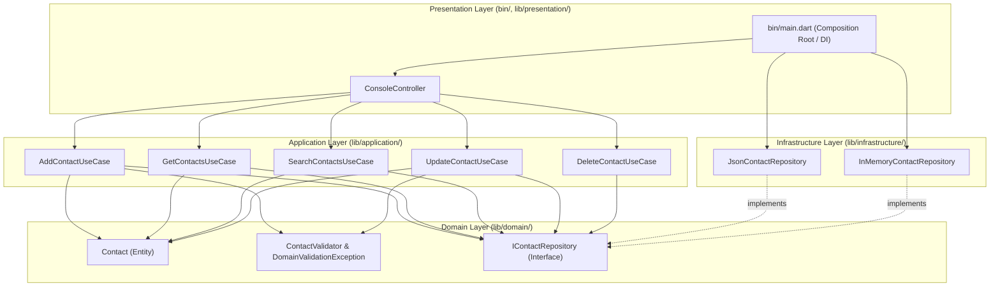

# stp-lab5-contact-book

**Лабораторна робота №5 з навчальної дисципліни «Сучасні технології проєктування»**  
**Тема:** Побудова архітектури застосунку (Clean Architecture). Робота з Git.  
**Предметна область (Варіант 19):** Консольний застосунок «Контакт-книга» (Contact Book CLI).  
**Виконав:** студент групи 4КІ2 Владислав НІЯКИЙ

---

## Опис проєкту

Застосунок реалізує повнофункціональну систему управління контактами на основі принципів **Clean Architecture** (шарувата архітектура з чітким розмежуванням відповідальності та дотриманням принципу інверсії залежностей — **Dependency Inversion Principle**).

Основні можливості:
- Додавання нового контакту з доменною валідацією імені, номера телефону та формату електронної пошти (`@` та домен).
- Перегляд списку контактів у табличному форматі з алфавітним сортуванням та фільтрацією обраних контактів (`★`).
- Пошук контактів за ім'ям, номером телефону, email або категорією.
- Редагування та видалення існуючих контактів.
- Гнучке перемикання сховища даних між **JSON-файлом** (`JsonContactRepository`) та **оперативною пам'яттю** (`InMemoryContactRepository`) через файл конфігурації `appsettings.json` без жодної зміни бізнес-логіки.

---

## Архітектура застосунку (Clean Architecture)

Проєкт поділений на 4 незалежні архітектурні шари. Напрямок залежностей спрямований виключно всередину (до ядра **Domain**):



### Структура каталогів

```text
stp-lab5-contact-book/
├── bin/
│   └── main.dart                                          # Точка входу (Composition Root, Dependency Injection)
├── lib/
│   ├── domain/                                            # Шар Domain (Бізнес-ядро, не має зовнішніх залежностей)
│   │   ├── entities/
│   │   │   └── contact.dart                               # Сутність Contact
│   │   ├── repositories/
│   │   │   └── i_contact_repository.dart                  # Абстрактний інтерфейс IContactRepository
│   │   └── validators/
│   │       └── contact_validator.dart                     # Бізнес-правила валідації та доменні винятки
│   ├── application/                                       # Шар Application (Сценарії використання / Use Cases)
│   │   └── use_cases/
│   │       ├── add_and_get_contacts_use_case.dart         # AddContactUseCase, GetContactsUseCase
│   │       └── manage_contacts_use_cases.dart             # SearchContactsUseCase, UpdateContactUseCase, DeleteContactUseCase
│   ├── infrastructure/                                    # Шар Infrastructure (Зовнішні сховища даних)
│   │   └── repositories/
│   │       ├── in_memory_contact_repository.dart          # Реалізація сховища в оперативній пам'яті
│   │       └── json_contact_repository.dart               # Реалізація збереження у JSON-файлі
│   └── presentation/                                      # Шар Presentation (Взаємодія з користувачем)
│       └── cli/
│           └── console_controller.dart                    # Консольний контролер та табличне форматування
├── appsettings.json                                       # Конфігурація застосунку та типу сховища
├── pubspec.yaml                                           # Конфігурація пакета Dart
└── README.md                                              # Документація проєкту
```

---

## Робочий процес у Git (Git Flow)

Розробка велася за моделлю гілкування **Git Flow**:
- `main` — стабільна релізна гілка (містить тег `v1.0.0`).
- `develop` — інтеграційна гілка розробки.
- `feature/domain-layer` — розробка сутностей, валідаторів та інтерфейсу репозиторію.
- `feature/application-layer` — реалізація Use Cases поверх абстракції `IContactRepository`.
- `feature/infrastructure-layer` — реалізація `InMemoryContactRepository` та `JsonContactRepository` (із розв'язанням змодельованого конфлікту злиття у `appsettings.json`).
- `feature/presentation-layer` — реалізація CLI-контролера, точки входу з Dependency Injection та документації.

---

## Інструкція зі збірки та запуску

### Вимоги
- Встановлений **Dart SDK** версії `>= 3.0.0`.

### Крок 1. Клонування репозиторію
```bash
git clone https://github.com/Vla123214521/stp-lab5-contact-book.git
cd stp-lab5-contact-book
```

### Крок 2. Запуск демонстраційного сценарію (всі Use Cases)
```bash
dart bin/main.dart
```

### Крок 3. Запуск в інтерактивному CLI-режимі
```bash
dart bin/main.dart --interactive
```
